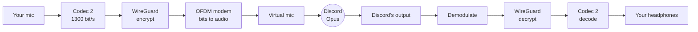

# How Harmonium works

Harmonium is a **proof of concept**: encrypted voice over an ordinary Discord call, where the
keys live only on the two people's machines and Discord carries nothing but noise. It works
live between Linux and Windows, it is slow and lossy, and nobody has audited it. Read it as a
demonstration of an idea, not as a tool to protect anything that matters.

## The idea

Most of our privacy today is a promise someone else keeps for us. Discord, to its credit, has
encrypted every voice call end to end since March 2026 (its DAVE protocol). But that encryption
lives inside Discord's client, with keys that Discord's servers help distribute. You are
trusting the company to ship the client it says it ships and to hand out the keys it says it
hands out.

Harmonium asks a different question: what if the platform never gets anything worth protecting
in the first place? You encrypt before the audio ever reaches Discord, with keys that you
generate and verify yourself. Discord becomes a dumb pipe that carries a hiss. The same trick
works over any app that carries a voice: that is the point. Privacy can be something you add
yourself, not only something you are granted.

## The pipeline

Each stage is a separate Rust crate with its own tests, and every stage also runs offline on
files, so the whole chain is tested without Discord.

### 1. Squeeze the voice: Codec 2 at 1300 bit/s

A normal Discord call spends about 64,000 bits per second on audio. Harmonium first compresses
speech with [Codec 2](https://github.com/drowe67/codec2), a codec built for ham radio, down to
**1,300 bits per second**: 52 bits for every 40 ms of speech. It sounds robotic, but it is clearly
understandable, and it leaves room for encryption overhead in a channel that can carry very
little.

### 2. Encrypt: a real WireGuard tunnel, no homemade crypto

The voice packets travel through a real **WireGuard** session
([GotaTun](https://github.com/mullvad/gotatun), Mullvad's Rust implementation): the Noise
handshake, ChaCha20-Poly1305, rekeying every two minutes, replay protection. Harmonium contains no
cryptography of its own; `cargo deny` fails the build if a crypto crate sneaks in any other way.

Keys are generated locally (`harmonium keygen`) and exchanged as a short bundle. You compare a
fingerprint with your friend outside Discord (in person, or a QR code) so Discord cannot swap
keys in the middle. Text messages use [age](https://age-encryption.org), pasted into the chat as
ASCII.

A post-quantum layer ([Rosenpass](https://rosenpass.eu) feeding WireGuard's preshared key) is on
the `pq-rosenpass` branch. It passes offline but has not run on a live call yet.

**Fail closed:** if the tunnel is down, Harmonium sends idle modem frames, never your plain
microphone.

### 3. Turn bits into sound that survives Discord: an OFDM modem

This is the hard part. Discord compresses audio with Opus, a codec designed to throw away
everything a human would not notice. Data is all "things a human would not notice". The modem
has to produce sound that comes out the other side bit-exact, or close enough for error
correction to fix.

Harmonium uses **OFDM**, the same idea as Wi-Fi and 4G, scaled down to the voice band:

- **34 tones**, 100 Hz apart, from 300 Hz to 3.7 kHz, each carrying 2 bits per symbol
  (**DQPSK**: the data is in the *change* of phase from one symbol to the next, so the receiver
  needs no channel estimate).
- **12 ms symbols** with a 2 ms cyclic prefix that absorbs Opus's smearing in time.
- Every frame starts with a **chirp** (a 600 Hz to 6 kHz sweep) that the receiver finds by
  correlation, independent of volume.
- **Reed-Solomon** error correction, four interleaved codewords per frame, so a burst of damage
  is spread thin across all of them. A CRC and COBS framing on top make sure a damaged packet is
  dropped, never delivered wrong.

*Three seconds of modem audio after Opus with 2% packet loss, as Discord would pass it on. The
vertical sweeps are the sync chirps; the band below 4 kHz is the 34 data tones. Every frame of
the 8-second clip decodes.* Make your own with
`cargo run --release -p channel-sim --example encode_wav -- out.wav`, then `channel-sim wav`.

Net result: about **3.3 kbit/s** of clean data through Discord, enough for Codec 2 plus
WireGuard's overhead.

The first layout used 68 tones up to 7 kHz and looked great in simulation (3.9 kbit/s through
Opus). On real Discord the upper tones fell apart, so the live data moved the design to the
narrower band. A second surprise: Discord occasionally drops or repeats a few milliseconds of
audio in the middle of a frame. The demodulator now tracks timing symbol by symbol, re-locking
on each cyclic prefix, which cut packet loss on the worst direction from 42% to 27%.

### 4. Plug into Discord without touching it

Harmonium never modifies Discord or automates an account. It appears to Discord as a microphone
(a PipeWire virtual device on Linux, VB-CABLE on Windows). On Windows it records Discord's own
output with WASAPI process loopback and turns Discord down in the volume mixer during the call,
so you hear your friend's decoded voice instead of the modem hiss.

## What it achieved

A live 10-minute Discord DM call between a Linux laptop and a Windows PC, Harmonium on both
ends:

| | Windows to Linux | Linux to Windows |
|---|---|---|
| Voice packets lost | 15% | 27% |
| Packets delivered corrupted | 0 | 0 |

Mouth to ear takes about 1.5 s one way. Every packet that arrived was decrypted and
authenticated; none arrived damaged. Losses show up as audible gaps. The text path (encrypt,
paste into Discord, copy back, decrypt) works exactly.

## What it is not

- **Not production software.** No audit, a 1.5 s delay, and gaps in the audio.
- **Not hidden.** Anyone listening hears a modem, not speech. Discord still sees who calls whom,
  when, and for how long. Harmonium protects what you say, not that you said something.
- **1:1 only**, with a manual one-time device setup in Discord for each call.

The full threat model is in [threat-model.md](threat-model.md); the modem design is in
[modem-spec.md](modem-spec.md).

## Inspiration

The spark came from Benn Jordan's video
[There Are Files Stored in This Video](https://www.youtube.com/watch?v=fhoJK02oD_E), about hiding
files inside a video. If data can ride along in media, then any app that carries your voice can
carry your encryption too, and the platform does not need to be trusted with it.
